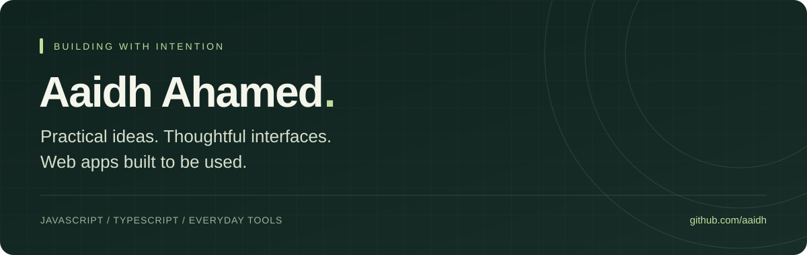

  

  <a href="https://aaidh.github.io/deadline-wallpaper/"><strong>Try my latest project ↗</strong></a>
  &nbsp; · &nbsp;
  <a href="https://www.linkedin.com/in/aaidh">LinkedIn</a>
  &nbsp; · &nbsp;
  <a href="https://github.com/aaidh?tab=repositories">All repositories</a>

### Hi, I’m Aaidh.

I build web apps around everyday needs — from keeping deadlines in sight to organising bills and turning QR codes into useful passes. I enjoy working on the details that make a tool clear, approachable, and easy to use.

My projects span lightweight browser tools and applications built with Next.js and TypeScript. I learn by building, testing, and improving what I ship.

### Selected work

<table>
<tr>
<td width="50%" valign="top">

#### [Deadline Wallpaper](https://github.com/aaidh/deadline-wallpaper)

Turn upcoming deadlines into a personalised phone wallpaper. Live canvas previews, five colour themes, iPhone presets, and high-resolution PNG exports.

`JavaScript` `Canvas` `CSS`

[Open app ↗](https://aaidh.github.io/deadline-wallpaper/)

</td>
<td width="50%" valign="top">

#### [PocketPass](https://github.com/aaidh/pocketpass)

Read a QR image locally, customise a pass, and download a QR PNG. Includes an optional Apple Wallet signing server that requires separate configuration.

`JavaScript` `Vite` `Node.js`

[Explore the project ↗](https://github.com/aaidh/pocketpass)

</td>
</tr>
<tr>
<td width="50%" valign="top">

#### [BillBuddy](https://github.com/aaidh/Bill-Buddy)

A mobile-first bill organiser with multiple currencies, due-date views, search, and browser-based storage.

`JavaScript` `HTML` `CSS`

[Explore the project ↗](https://github.com/aaidh/Bill-Buddy)

</td>
<td width="50%" valign="top">

#### [DT Marketplace](https://github.com/aaidh/DT-Marketplace)

A local classifieds project for Dharga Town and surrounding communities, with listings, categories, and moderation workflows.

`Next.js` `TypeScript` `Prisma`

[Explore the project ↗](https://github.com/aaidh/DT-Marketplace)

</td>
</tr>
</table>

**Also exploring:** [PillPulse](https://github.com/aaidh/pill-pulse), a medication tracking interface, and [Alan Gems](https://github.com/aaidh/Alan-Gems), a gemstone storefront project.

### Tools I work with

**Frontend** &nbsp; JavaScript · TypeScript · HTML · CSS · Tailwind CSS · Next.js  
**Application tools** &nbsp; Node.js · Prisma · PostgreSQL · Firebase  
**Workflow** &nbsp; Git · GitHub · GitHub Pages

### What I care about

- **Useful by design:** start with a real task and make it easier.
- **Clear interfaces:** readable layouts, responsive screens, and straightforward controls.
- **Honest documentation:** explain how a project works, what is ready, and what still needs configuration.

---

Small tools. Real problems. Always improving.

